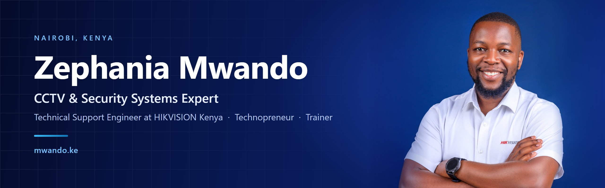
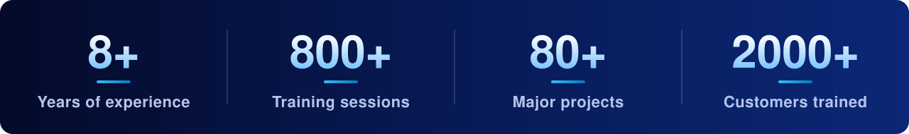

  
  
  
  

  <picture>
    <source media="(prefers-color-scheme: dark)" srcset="https://streak-stats.demolab.com/?user=mwandotheboss&hide_border=true&card_width=860&theme=tokyonight" />
    
  </picture>

## 🚀 About me

> 👋 **Zephania** on my certificates, **Zeph** everywhere else. You can call me Zeph.

I'm a **CCTV, Security Systems and AV Solutions expert** based in Nairobi, Kenya, currently a **Technical Support Engineer at HIKVISION Kenya**. I'm also a technopreneur and software developer at heart, always exploring where security tech meets emerging technology.

- 🔭 Working on **The Smart Parent**, an Android app built with Kotlin and Firebase
- 🛡️ Specialising in **video surveillance, access control, network security and system integration**
- 🎓 Training system integrators and security teams, and a former **Google Digital Skills for Africa** trainer
- 🌱 Learning **Kotlin, Flutter, Node.js and React**
- 💬 Ask me about **security technology, business development and enterprise solutions**
- 📝 I write technical guides and product breakdowns on [mwando.ke/blog](https://mwando.ke/blog)
- ⚡ Fun fact: **I play FIFA and can make you sweat 😂**

  

## 💼 Experience

<table>
  <tr>
    <td width="170" valign="top"><b>Oct&nbsp;2025&nbsp;–&nbsp;Present</b></td>
    <td>
      <b>Technical Support Engineer</b> · HIKVISION Kenya
      <ul>
        <li>Leading testing, commissioning and technical support for advanced surveillance and security systems</li>
      </ul>
    </td>
  </tr>
  <tr>
    <td width="170" valign="top"><b>Mar&nbsp;2025&nbsp;–&nbsp;Sep&nbsp;2025</b></td>
    <td>
      <b>Solution Manager</b> · Dahua Technology Kenya
      <ul>
        <li>Led strategy and delivery of AI-driven surveillance, ANPR, access control and smart-parking solutions across Kenya, Uganda, Tanzania, Rwanda and Burundi</li>
        <li>Managed and mentored a multidisciplinary team of engineers and integrators, from requirements gathering to client handover</li>
        <li>Shaped regional solution strategy, pricing and partner offerings for a 30% uplift in project wins</li>
        <li>Certified 150+ professionals on Dahua DSS, IVS and ANPR, and cut support incidents by 25% with KPI dashboards</li>
      </ul>
    </td>
  </tr>
  <tr>
    <td width="170" valign="top"><b>Sep&nbsp;2024&nbsp;–&nbsp;Feb&nbsp;2025</b></td>
    <td>
      <b>Senior Project Engineer</b> · Dahua Technology Kenya
    </td>
  </tr>
  <tr>
    <td width="170" valign="top"><b>Jan&nbsp;2022&nbsp;–&nbsp;Nov&nbsp;2024</b></td>
    <td>
      <b>Pre-Sales Engineer</b> · Dahua Technology Kenya
      <ul>
        <li>🏆 Named Dahua's global <b>Outstanding DSS Instructor of the Year 2023</b></li>
        <li>Product selection and solution reviews for 106 projects, with 23 solutions procured</li>
        <li>Configured 1,623 video devices, 300 access control devices and a DSS Professional video intercom rollout of 126 outdoor, 315 indoor and 14 master stations</li>
        <li>Delivered 300+ training sessions and advised 200+ customers on site and remotely</li>
      </ul>
    </td>
  </tr>
</table>

<b>Earlier roles (2018 – 2022)</b>

 

<table>
  <tr>
    <td width="170" valign="top"><b>Oct&nbsp;2021&nbsp;–&nbsp;Dec&nbsp;2021</b></td>
    <td>
      <b>Solutions Assistant Engineer</b> · Dahua Technology Kenya
      <ul>
        <li>Product selection, solution design, and on-site and remote technical support</li>
        <li>Configured DSS video intercom for 24 outdoor, 245 indoor and 2 master stations</li>
        <li>Ran 23 training sessions for 156 clients and advised 93+ customers</li>
      </ul>
    </td>
  </tr>
  <tr>
    <td width="170" valign="top"><b>Jun&nbsp;2021&nbsp;–&nbsp;Jan&nbsp;2022</b></td>
    <td>
      <b>Mentor, Associate Android Developer</b> (part-time) · Andela
    </td>
  </tr>
  <tr>
    <td width="170" valign="top"><b>Jul&nbsp;2021&nbsp;–&nbsp;Oct&nbsp;2021</b></td>
    <td>
      <b>Chief Technical Officer (CTO)</b> · Imax Technologies Limited, official Dahua Technology distributor
      <ul>
        <li>Technical support and customer training on security, video intercom, alarm and access control systems</li>
      </ul>
    </td>
  </tr>
  <tr>
    <td width="170" valign="top"><b>Jan&nbsp;2020&nbsp;–&nbsp;Jun&nbsp;2021</b></td>
    <td>
      <b>Service Delivery Executive</b> · OpenBusiness Africa
      <ul>
        <li>Recruited, trained and managed 42 implementation consultants, and gave job-skills training to 264 candidates</li>
        <li>Trained 1,600+ business owners, in person and virtually, on the OpenBusiness mobile point of sale</li>
        <li>Tested three software releases and reported 128+ issues that were resolved</li>
      </ul>
    </td>
  </tr>
  <tr>
    <td width="170" valign="top"><b>Aug&nbsp;2019&nbsp;–&nbsp;Dec&nbsp;2019</b></td>
    <td>
      <b>Intern</b> · Openworld Kenya LTD
      <ul>
        <li>Trained 1,048 people as a Google Digital Skills for Africa trainer</li>
        <li>Supported 283 customers in setting up and using the mobile point of sale system</li>
      </ul>
    </td>
  </tr>
  <tr>
    <td width="170" valign="top"><b>Dec&nbsp;2018&nbsp;–&nbsp;May&nbsp;2019</b></td>
    <td>
      <b>Marketing Assistant</b> · Hasbah Kenya Limited
      <ul>
        <li>Marketing for Eveready and Energizer batteries</li>
      </ul>
    </td>
  </tr>
</table>

### 🎓 Education and certification

- **Bachelor of Technology in Communication and Computer Networks**, Technical University of Kenya (2015 – 2019), Second Class Upper Division
- **Associate Android Developer**, Google Africa (2020 – 2021)

Full résumé at [mwando.ke/#resume](https://mwando.ke/#resume).

## 🛠️ Languages and tools

  

<b>Text version</b>

 

- **Languages:** Java · Kotlin · Dart · JavaScript · TypeScript · PHP · HTML5 · CSS3
- **Mobile:** Android · Flutter · Firebase · SQLite · Google Maps SDK
- **Web and backend:** React · Angular · Node.js · Express · Sequelize · Bootstrap · WordPress · REST APIs · MQTT
- **Databases:** MySQL · PostgreSQL · SQLite · Oracle
- **Cloud and infrastructure:** AWS · Azure · Google Cloud · Docker · Kubernetes · GitHub Actions
- **Tools and design:** Git · GitHub · Postman · VS Code · Figma · Adobe XD · Photoshop · Illustrator · Premiere Pro
- **Systems and networking:** Operating system deployment · Virtual machines and virtualisation · Windows Server · Linux · Ubuntu · CentOS · Active Directory · LAN/WAN/VLAN design · VPNs · Firewall configuration · Network security
- **Security systems:** CCTV and video surveillance · ANPR · Access control · Video intercom · Intrusion alarms · Smart parking · HikCentral · Dahua DSS

## 📌 Featured projects

<table>
  <tr>
    <th width="340" align="left">Project</th>
    <th width="700" align="left">What it is</th>
  </tr>
  <tr>
    <td><a href="https://smartware.africa/"><b>Smartware Africa Technologies</b></a></td>
    <td>Tech company and technology partner for businesses</td>
  </tr>
  <tr>
    <td><b>The Smart Parent</b></td>
    <td>Android app built with Kotlin and Firebase</td>
  </tr>
  <tr>
    <td><a href="https://sokobure.co.ke/"><b>SokoBure Marketplace</b></a></td>
    <td>Online shopping marketplace</td>
  </tr>
  <tr>
    <td><b>SMSSCAPE</b></td>
    <td>SMS message printing tool</td>
  </tr>
  <tr>
    <td><b>Arculens</b></td>
    <td>Photography brand</td>
  </tr>
</table>

More at [mwando.ke/#portfolio](https://mwando.ke/#portfolio).

### ⭐ Top public projects on GitHub

<!-- TOP-PROJECTS:START -->
<table>
  <tr>
    <th width="330" align="left">Repository</th>
    <th width="520" align="left">What it does</th>
    <th width="130" align="left">Built with</th>
    <th width="60">⭐</th>
  </tr>
  <tr>
    <td><a href="https://github.com/mwandotheboss/Obuyanzi-Hymns"><b>Obuyanzi-Hymns</b></a></td>
    <td>A digital home for traditional Luhya hymns, in Luhya and English</td>
    <td>Dart</td>
    <td align="center">2</td>
  </tr>
  <tr>
    <td><a href="https://github.com/mwandotheboss/Dahua-ANPR-Integrations"><b>Dahua-ANPR-Integrations</b></a></td>
    <td>Node.js integration for Dahua ANPR cameras: snapshots, digest authentication and real-time number plate recognition</td>
    <td>JavaScript</td>
    <td align="center">1</td>
  </tr>
  <tr>
    <td><a href="https://github.com/mwandotheboss/Hik-Connect-Integrations"><b>Hik-Connect-Integrations</b></a></td>
    <td></td>
    <td></td>
    <td align="center">0</td>
  </tr>
  <tr>
    <td><a href="https://github.com/mwandotheboss/HikCentral-Professional-Integrations"><b>HikCentral-Professional-Integrations</b></a></td>
    <td></td>
    <td></td>
    <td align="center">0</td>
  </tr>
  <tr>
    <td><a href="https://github.com/mwandotheboss/HikCentral-Access-Control-Integrations"><b>HikCentral-Access-Control-Integrations</b></a></td>
    <td></td>
    <td></td>
    <td align="center">0</td>
  </tr>
  <tr>
    <td><a href="https://github.com/mwandotheboss/Dahua-DSS-Integration"><b>Dahua-DSS-Integration</b></a></td>
    <td>Integration with the Dahua DSS platform</td>
    <td>JavaScript</td>
    <td align="center">0</td>
  </tr>
</table>
<!-- TOP-PROJECTS:END -->

See all repositories on [GitHub](https://github.com/mwandotheboss?tab=repositories).

## 📊 GitHub stats

  
  

## 🤝 Connect with me

  
  
  
  
  
  
  
  

  📫 <a href="mailto:hello@mwando.ke">hello@mwando.ke</a> · 📞 <a href="tel:+254117155555">+254 117 155 555</a> · 📍 Nairobi, Kenya

---

<em>Change is inevitable. Embrace it!</em>

